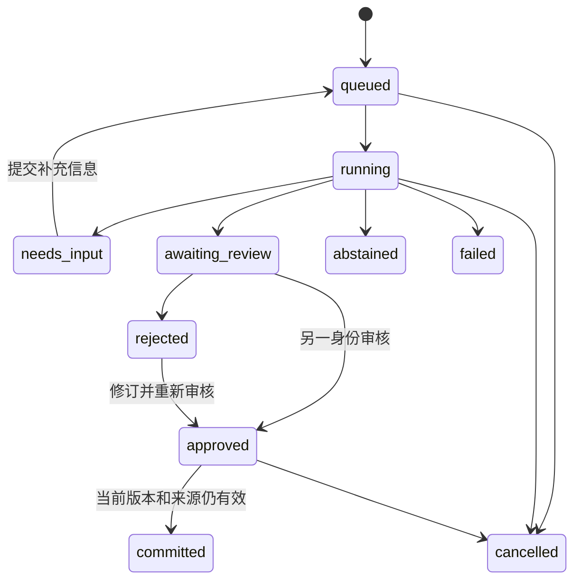

# CaseDesk：把 Agent 做成可以交接的工程项目

[课程首页](../../README.md) · [学习实验](learning-lab.md) · [数据与评测](data.md) · [部署与恢复](operations.md) · [课程价值验收](student-value.md)

课程的综合项目是一套知识与工单协作台。申请人提出问题；系统查合成案例与版本化资料，必要时补问；审核人核对并修订答复；申请人提交工单。页面、API、后台任务、资料索引、审核事务和下游投递组成同一条可追踪链路。

对大学生而言，重点是把代码变成能解释的工程判断：为什么有了 JSON 还要验证工具，为什么取消不等于撤销，为什么引用正确仍须审核，为什么接口快速返回不代表后台有容量。先完成[基础练习](../practice.md)与[项目 04–05](../projects/README.md)，再进入这里。

## 先跑通一次完整流程

需要 Python 3.11+，先在仓库根目录创建虚拟环境。macOS / Linux：

```bash
python3 -m venv .venv
source .venv/bin/activate
```

Windows PowerShell：

```powershell
py -3 -m venv .venv
```

Windows 接下来的每个 `python` 都替换成 `.\.venv\Scripts\python.exe`，不依赖脚本执行策略。然后安装固定版本的应用依赖和课程包：

```bash
python -m pip install -r requirements-desk.lock
python -m pip install -e . --no-deps
python -m agentlab.desk init --data-dir work/casedesk --demo
python -m agentlab.desk serve --data-dir work/casedesk
```

浏览器打开 `http://127.0.0.1:8766`。在本地编辑器打开 `work/casedesk/auth.json`，找到 `campus-requester` 的 `token`，粘贴到页面；它是随机生成的本地访问凭据，不能放进截图、作业报告或 Git。页面只在内存保存它，刷新后需要重新连接。`partner` 是另一个隔离工作区，不能审核 `campus` 的任务。

1. 输入“CASE-1001 使用原支付银行卡，退款获批后预计多久到账？不要计算具体日期。”，选择“直接检索”，创建任务。
2. 刷新任务状态。看到“待审核”后，检查答复里的条件和引文；检索命中不等于已经回答完整。
3. 断开连接，用 `campus-reviewer` 凭据进入同一工作区。打开任务，通过“查看原文片段”核对依据，修改答复后批准。这个问题应区分“获批后预计 2 个工作日”和“已经到账”，保留周末、节假日和地区日历条件。
4. 换回申请人，提交工单，确认页面显示工单编号。下面的 smoke 脚本还会检查相同幂等键的重放是否返回同一工单。
5. 另建一条相同问题的任务并完成批准，**先不提交**。换审核人，在“资料”中撤回答复引用的“支付通道结算与进度排查”；换回申请人尝试提交，应收到旧引用失效错误。重新检索不会取回撤回资料，因此必须保留撤回前的任务才能观察此反例。
6. 练习后，在该文档卡片选择“准备更新”，把[原始合成正文](../../src/agentlab/desk/documents/payment-settlement.md)完整填入并发布；表单会带入当前 revision。随后新建任务再查。重导产生新版本，旧任务不会自动恢复批准。

页面可以改写答复，当前引文集合沿用该任务已有引文；需要改变引文集合时使用有版本检查的审核 API，或新建任务重新取得证据。不要在现有引文不能支持时批准一个更完整但无依据的答案。

这次手动操作是真实使用练习，仍不代表已经测量学习效果。只想先检查安装时，运行 `python scripts/smoke_desk.py`；该命令使用临时资料和模拟审核人，结束后清理进程及数据库。

## 哪些能力已经接在一起

| 操作 | 实现位置 | 可以追问的问题 |
| --- | --- | --- |
| 从原始 Markdown 导入、切块、更新、撤回 | [knowledge.py](../../src/agentlab/desk/knowledge.py) | 更新同一文档时怎样使旧引用失效？ |
| 查询案例、按观察继续检索或补问 | [planner.py](../../src/agentlab/desk/planner.py)、[engine.py](../../src/agentlab/desk/engine.py) | 为什么模型不能指定租户或直接批准？ |
| 队列、租约、恢复、取消 | [store.py](../../src/agentlab/desk/store.py) | 老 worker 晚返回，如何阻止它覆盖新状态？ |
| 语义审核、版本绑定、工单和 outbox | [store.py](../../src/agentlab/desk/store.py) | 批准后资料被撤回，提交还能成功吗？ |
| 身份、权限、限流、页面与独立 worker | [api.py](../../src/agentlab/desk/api.py) | 慢模型为什么不会占住 HTTP 事件循环？ |
| 故障演练与公平检索对照 | [测试](../../tests/)、[检索诊断](data.md) | 对照改了哪些变量？失败题去了哪里？ |

“直接检索”是固定对照：识别案例编号后查询记录，检索一次，返回最多三个片段。“模型协作”由显式选定的本地 Ollama 模型决定只读动作，可继续查资料或补问。两种方式只要产生答案草稿，都须人工审核；无依据可拒答，缺少必要条件可补问，运行错误会失败。模型模式不会自动下载权重或改用付费 API。

```bash
python -m agentlab.desk serve --data-dir work/casedesk --model YOUR_INSTALLED_LOCAL_MODEL
```

先确认选定模型确实在本机 Ollama 中，且有足够资源。默认单次模型调用最多 40 秒、2,048 个输出 token；每个调查回合最多 90 秒；一个任务累计最多 8 个决策，补问后不重置决策步数。超时、截断、无效提案都作为失败记录，不偷偷换模型。模型表现以实际运行报告为准，不能由协议测试推断。检索对照见[完整逐题报告](../../data/desk/retrieval-diagnostic.json)。

## 状态与证据



每个任务有持久化事件序列。模型提案先保存，再执行只读工具；进程崩溃后可能重复尚未保存结果的只读查询。租约与递增 fencing token 阻止旧 worker 回写。提交在单个数据库事务中创建唯一工单、操作回执和 outbox；外部交付需要独立消费者幂等，不能由本地事务推导“全世界只执行一次”。

知识库与任务库按固定顺序加锁，只在验证和落库期间持有，模型调用不持有数据库写锁。审核绑定答复和引用摘要，默认 10 分钟有效；过期后由审核人再次核对。撤回保留历史，不能当作物理删除。

## 下一步交自己的作品

按[四轮学习实验](learning-lab.md)完成独立变化，保存失败与修复证据；再做[牛客线索改写的十二个深挖场景](../interview/deep-dives.md)。使用参考工程可以缩短搭环境时间，简历应写清自己的设计、修改和测量，不能把仓库所有功能都归为个人独立完成。
